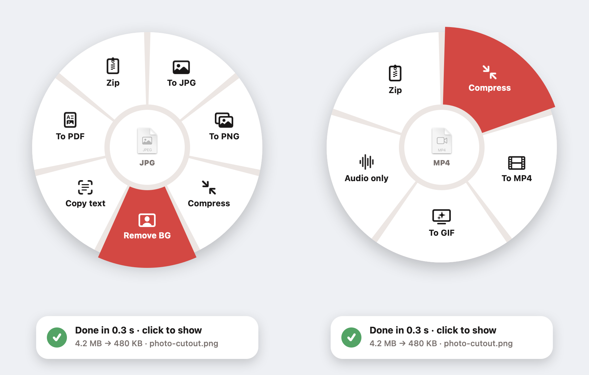

<p align="center"></p>

# Morph

**Hold ⇧ Shift while dragging any file on your Mac, and a ring of actions opens under your cursor.** Drop the file on one and it's done in a second, saved right next to the original. Everything runs on your Mac, offline: no uploads, no websites, no account.

### [⬇️ Download Morph (free)](https://github.com/rajmans123-netizen/morph/releases/latest/download/Morph.zip)

<p align="center"></p>

| Drag a… | You get |
|---|---|
| Photo | To JPG · To PNG · Compress · **Remove background** · **Copy text** · To PDF · Zip |
| Video | Compress · To MP4 · To GIF · Audio only · Zip |
| PDF | Compress · To images · Copy text · Merge (drag several) · Zip |
| Audio | To M4A · To WAV · Zip |
| Word / RTF / text | To PDF · Zip |

## Install
1. Download **Morph.zip**, unzip it, and drag **Morph** into **Applications**.
2. Open it. Morph isn't signed with a paid Apple developer ID, so the first time macOS says it can't verify the app. Go to **System Settings → Privacy & Security**, scroll down and click **Open Anyway**.
3. A ring icon appears in your menu bar. Now hold **Shift** while dragging any file.

To have it start with your Mac, use the menu bar icon → **Open at login**.

Needs macOS 14 Sonoma or newer. Works on Apple silicon and Intel Macs.

## Build it yourself
```sh
./build.sh   # needs the Xcode Command Line Tools (swiftc); output: build/Morph.app
```

## Credits
The Shift-drag ring idea comes from **[Tangerine](https://www.instagram.com/th2049/) by Thameem (@th2049)**. Go check it out. Morph is an independent rebuild written from scratch with [Claude](https://claude.ai) for [Raj Tries](https://www.instagram.com/raj_triess/), build 8 of 30. No code or assets from Tangerine are used.

MIT licence.
